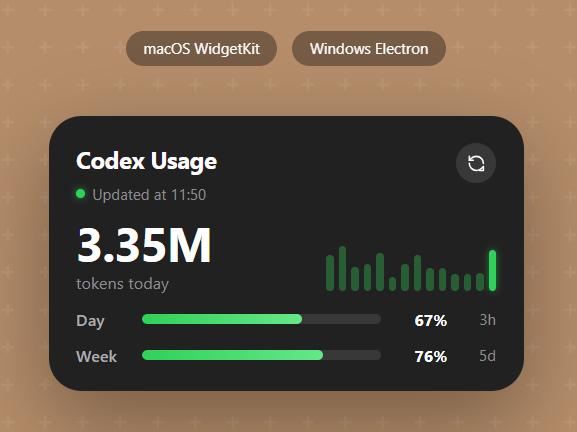

# Codex 额度余量监视器


跨平台的 Codex / OpenAI 额度桌面监视器。

- **macOS**：原生桌面小组件（WidgetKit / SwiftUI），与截图样式一致。
- **Windows**：透明置顶小窗（Electron），复刻同样外观。

打开 [`preview.html`](preview.html) 可直接看到设计预览。

## 下载
-Windows用户 推荐下载 Codex Usage Setup 1.0.4.exe，双击一路下一步安装。装完会在桌面/开始菜单出现图标，打开后输入 OpenAI API Key 就可使用。想绿色运行不下安装的，下载 Codex Usage 1.0.4.exe，双击就能打开。
-MacOS用户 目前 Release 里没有 macOS 的 .dmg，因为 macOS 应用必须签名才能在别人的电脑上运行。要自动构建 macOS 安装包，需要一个 Apple Developer 账号，仍在努力开发中

## 功能

- 实时显示今日已用 token 数
- Day / Week 两条进度条与百分比（根据月度订阅额度自动计算日/周额度）
- 最近 N 天用量柱状图，最右侧为今天
- 显示上次刷新时间（Updated at HH:MM）
- 刷新按钮
- 右键 / 设置面板配置 API Key 与月度额度

## 关于API key
- A. 你有 OpenAI Platform 的 API key（platform.openai.com 生成的 sk- 密钥）→ 输入 API key 本来就是正确方式，我可以帮你加"自动读 Codex 凭证"按钮，以后点一下就行。
- B. 你只用 ChatGPT Plus/Pro 订阅，没有 API key → 那 OpenAI 没给第三方查额度的接口，我们的工具目前查不到你的真实额度，只能在 ChatGPT 网页里看。这种情况你需要去 platform.openai.com 免费生成一个 API key 才能用这个工具（生成 key 不影响你的订阅）。

## 目录

```
.
├── core/               # 共享数据模型与计算逻辑（TypeScript）
├── windows/            # Windows 桌面小部件（Electron）
├── macos/              # macOS 桌面小组件（WidgetKit）
├── preview.html        # 浏览器可直接打开的设计预览
└── README.md           # 本文件
```

## 快速预览

直接用浏览器打开 `preview.html` 即可看到组件效果（使用演示数据）。

## Windows 使用

### 环境要求

- Node.js 18+

### 安装与运行

```bash
cd windows
npm install
npm start
```

### 打包

```bash
npm run build
```

打包后会生成 `dist/Codex Usage.exe` 便携版。

### 配置

右键点击小部件 → 打开设置面板，填入：

- **API Key**：你的 OpenAI / Codex API Key
- **Price per 1M tokens**：每百万 token 价格（默认 5.0 美元，用于把订阅的美元额度换算成 token 数）
- **Monthly quota fallback**：月度额度回退值（默认 150,000,000；当无法从订阅接口获取额度时使用，日限额=月/30，周限额=月/4）
- **Provider**：选择 `OpenAI / Codex` 或 `Mock`（演示数据）

配置保存在 `~/.codex-usage-widget/config.json`。

## macOS 使用

见 [`macos/README.md`](macos/README.md)。

简言之：

1. 用 XcodeGen 或手动创建 Xcode 工程。
2. 为主 App 和 Widget Extension 开启 App Group `group.com.codexusage.widget`。
3. 运行一次主 App 配置 API Key 与限额。
4. 将小组件添加到桌面。

## 数据来源

1. **月度 token 额度**：优先调用 OpenAI `/dashboard/billing/subscription` 获取订阅的 `hard_limit_usd` / `system_hard_limit_usd`，再按设置的 **Price per 1M tokens** 自动换算成月度 token 额度；获取失败时回退到配置的 `monthly_quota`。
2. **今日用量**：调用 OpenAI `/v1/usage?date=YYYY-MM-DD` 获取当天计费金额，再按 $0.000005/token 的近似比例换算成 token 数。

如果你的 Codex 服务提供独立的额度接口，只需修改对应平台的请求地址和解析逻辑：

- Windows：`windows/main.js` 中的 `fetchOpenAIUsage` 与 `fetchMonthlyQuota`
- macOS：`macos/CodexUsageWidget/Shared/UsageData.swift` 中的 `fetchOpenAIUsage` 与 `fetchMonthlyQuota`
- Core 参考：`core/src/fetcher.ts`

## 自定义限额

| 平台 | 配置文件 |
|------|----------|
| Windows | `~/.codex-usage-widget/config.json` |
| macOS | 通过主 App 设置，存储在 App Group 共享 UserDefaults |

## 发布发行（给别人用）

> 重要前提：两个平台都要求**用户自己填自己的 API Key** 才能看到真实额度；程序本身不含任何密钥。

### Windows（你这台 Windows 就能直接打包）

1. 安装依赖：`cd windows && npm install`
2. 打包：`npm run build`
3. 产物在 `windows/dist/`：
   - `Codex Usage.exe` —— 单文件便携版，双击即用，直接发别人最方便。
   - `Codex Usage Setup *.exe` —— 标准安装向导（已启用 NSIS）。
4. 发布：把 exe 直接微信/网盘发走，或推到 GitHub Releases（见下方）。
5. 代码签名（消除 SmartScreen 拦截，可选）：设置 `CSC_LINK` / `CSC_KEY_PASSWORD` 后重新 `npm run build`。

### macOS（**不能在 Windows 上编译**，需要 Mac 或 Mac 构建机）

macOS 应用 / 小组件**必须在 macOS 环境用 Xcode 编译**，Windows 上无法生成 .dmg。两个可行办法：

- **办法 A（推荐，你不用买 Mac）**：用 GitHub Actions 的 `macos` 构建机自动打包。
  仓库已放好 `.github/workflows/build-macos.yml`。你只需：
  1. 注册 Apple Developer 账号（$99/年）。
  2. 创建 App ID `com.codexusage.widget`、App Group `group.com.codexusage.widget`、Mac 分发描述文件。
  3. 把证书 .p12、描述文件、Team ID 作为仓库 Secrets 配好。
  4. 打 tag（如 `v1.0.0`）或手动触发 workflow，GitHub 的 Mac 机器自动产出 `Codex Usage.dmg` 并上传到 Release。
- **办法 B**：你有一台 Mac，装好 Xcode，本地执行：
  ```bash
  cd macos && xcodegen generate
  # 在 Xcode 里给两个 target 开 App Group + 签名
  xcodebuild -scheme CodexUsageWidget -configuration Release archive
  # 导出 .app 后用 create-dmg 生成 .dmg
  ```

#### .dmg 是什么、用户怎么装

.dmg 是 macOS 的「磁盘映像」。用户下载后：
1. 双击 `.dmg` → 系统挂载它。
2. 把里面的 `Codex Usage.app` 拖到「应用程序」文件夹。
3. 首次打开若提示「无法验证开发者」，右键 `Codex Usage.app` → 打开（或终端 `xattr -cr /Applications/Code\ Usage.app`）即可。
4. 打开一次主 App 填好 API Key → 桌面右键「编辑小组件」→ 添加 Codex Usage。

> 我们的小组件是嵌在主 App 里的扩展，所以只要分发主 App（.dmg 里那个 .app），小组件就一起装好了。

### 用 GitHub Releases 统一发布（两个平台都适用）

仓库已放好：
- `.github/workflows/build-windows.yml`（在 windows 构建机打包 exe）
- `.github/workflows/build-macos.yml`（在 macos 构建机打包 dmg）

流程：把代码推到 GitHub → 打一个 tag（如 `v1.0.0`）→ 两个 workflow 自动构建并把 exe / dmg 上传到该 Release。把 Release 链接发给别人即可。

## 许可证

MIT
